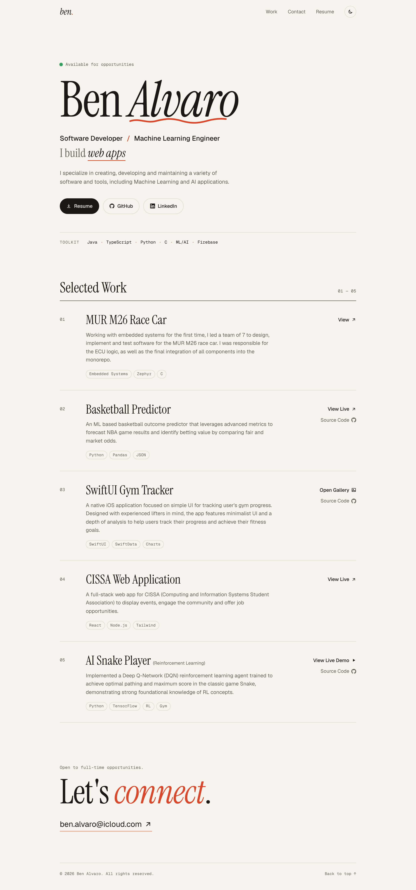
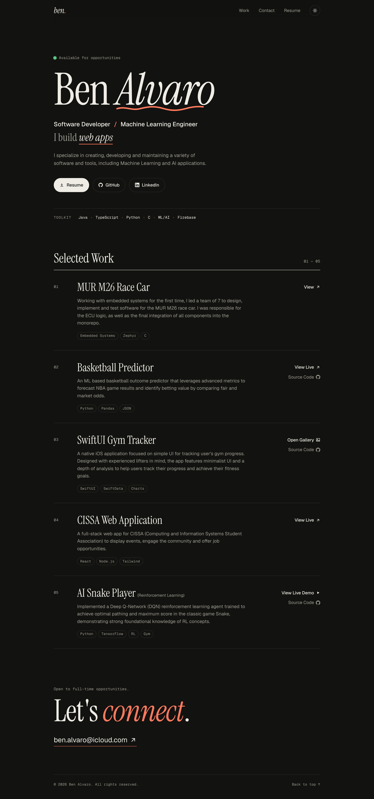
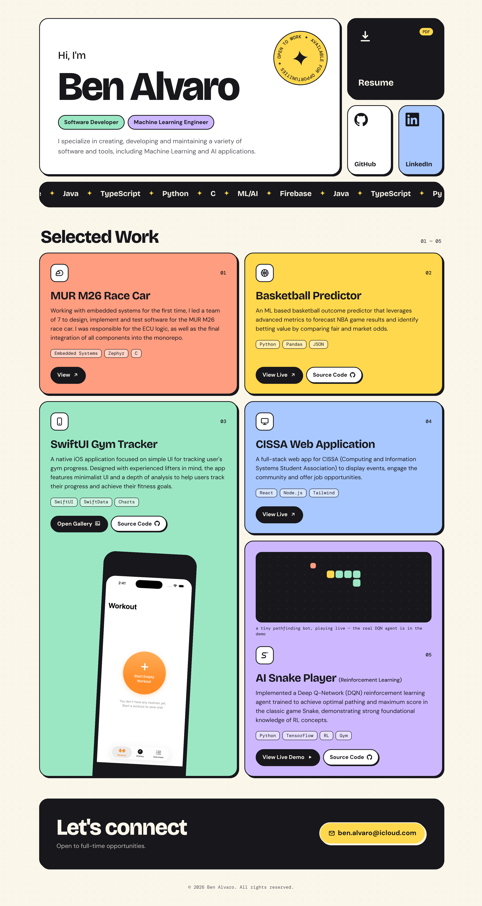

# Website redesign — two concepts

Two complete, working front-end redesigns of benalv.dev. Both keep the existing
content (bio, skills, five projects, gallery, Snake video, Basketball Predictor
demo, contact) and replace the Tailwind CDN + Lucide setup with plain HTML, CSS
and a single small script each — no build step, no JS dependencies.

The live site (`/index.html`, `/basketball.html`) is untouched until a concept is chosen.

| | Concept A — Ink & Paper | Concept B — Bento Playground |
|---|---|---|
| Folder | [`a/`](a/) | [`b/`](b/) |
| Mood | Editorial, typographic, calm | Colour-blocked, chunky, playful |
| Layout | Single column, numbered project index | Bento grid of tiles |
| Type | Instrument Serif + Geist | Bricolage Grotesque + DM Sans |
| Theme | Light and dark (toggle, remembers choice) | Light |
| Fun bits | Hand-drawn underline that draws itself, rotating "I build …" line, hover-shifting project rows | Spinning "available" sticker, skills marquee, phone that pops up on hover, a snake game that plays itself |

## Preview

| A (light) | A (dark) | B |
|---|---|---|
|  |  |  |

## Run locally

From the repository root (the pages reference `../../assets` and the resume PDF):

```bash
python3 -m http.server 8000
```

Then open `http://localhost:8000/redesign/a/` or `http://localhost:8000/redesign/b/`.

## Files (same in each concept)

- `index.html` — portfolio page
- `basketball.html` — Basketball Predictor live demo (predictions render as cards instead of raw text)
- `style.css` — all styles; colours and fonts are CSS variables at the top
- `main.js` — modals, gallery, video, scroll reveal, demo fetch

## Notes

- Modals use the native `<dialog>` element (Esc, focus trapping and backdrop for free).
- Animations are disabled under `prefers-reduced-motion`.
- The snake board in Concept B is a small breadth-first-search bot for decoration, labelled as such; the real DQN agent is still the video demo.
- Going live with a concept means moving its four files to the repo root and changing `../../` paths to `./`.
